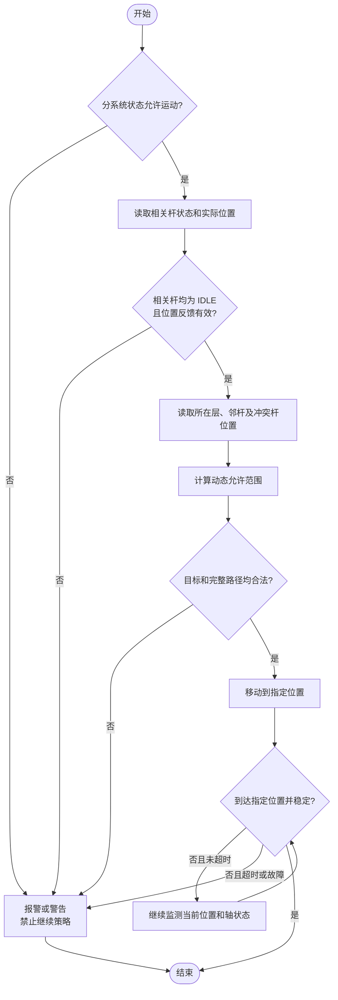
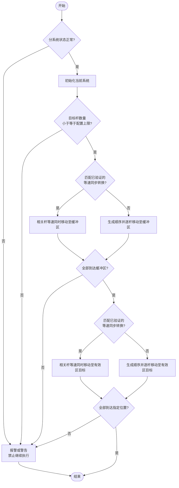
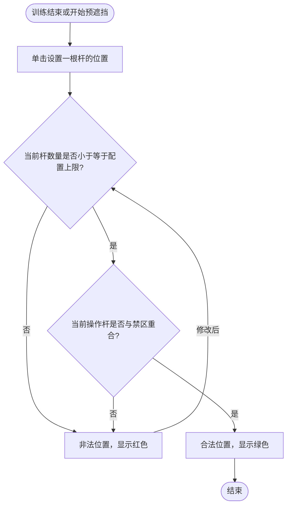
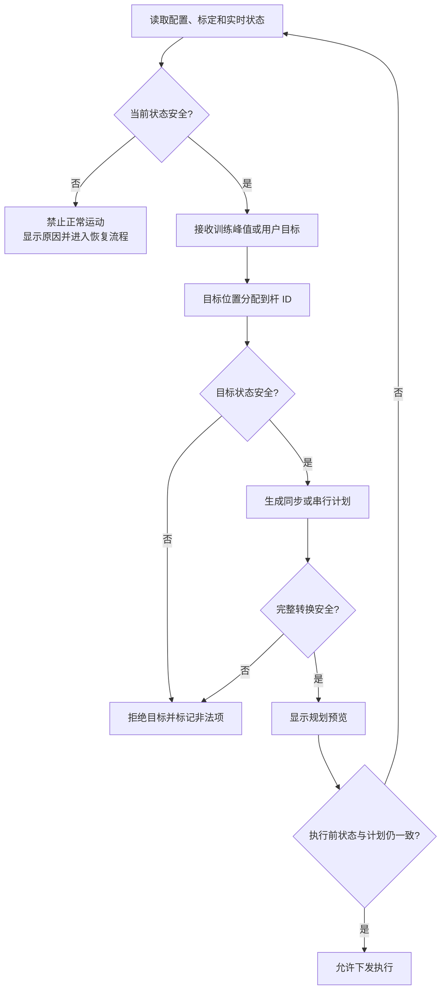
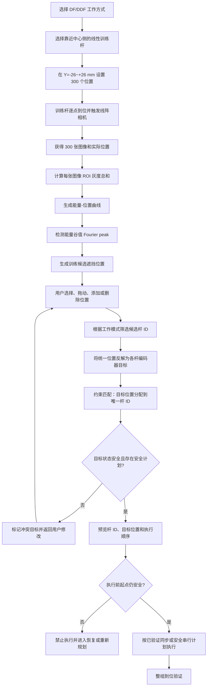

# 可编程光学遮挡棒坐标与运动规划设计

## 1. 文档目的

本文用于整理可编程光学遮挡模块的坐标定义、配置参数、安全约束、单杆运动策略、标定方法和自动规划流程，作为后续软件设计、配置表设计、联调与测试的基础。

> 实施说明（FF GUI 1.0）：正式配置使用 `rod_layers.csv` 和 JSON `layer_members`：每行是一个 `(channel_id, rod_id, layer)` 成员关系；layer 为普通整数，跨层 Rod 写多行，且每层分别记录和校验 `role`、`left_neighbor`、`right_neighbor` 与成对间隙规则。坐标标定字段以 `P0`、`P1` 为准，当前公式为 `optical_position = P0 + P1 * u`，其中 `u` 为 encoder position。

当前系统由 `N` 个独立电机驱动 `N` 根遮挡棒，并允许：

- 遮挡棒从单侧平行伸入，或从两侧相向进入；
- 多根遮挡棒处于同一机械层；
- 设置额外的定点运动层；
- 单根遮挡棒跨越或占用多个层；
- UI 一次规划多根杆；物理层默认逐杆运动，已验证的安全状态转换允许多杆等速同时运动；
- 形成非等距、不规则的光学遮挡图案。

已知机械和控制条件：

| 项目 | 当前定义 |
|---|---|
| 遮挡棒直径 | 1 mm |
| 相邻棒中心距 | 3 mm |
| 相邻棒理论净间隙 | 2 mm |
| 电机布置 | 在运动方向上前后错开，以保证直线电机行程 |
| 棒所在平面 | 与光轴垂直 |
| 典型电机行程 | 约 90 mm |
| 编码器分辨级数 | 4096 级 |
| 定位精度 | 小于 50 μm |

> 3 mm 是中心距，不是运动方向上的防碰撞安全距离。实际安全距离仍需考虑棒径公差、安装误差、直线度、振动、定位误差及控制余量。

---

## 2. 核心设计原则

1. 光瞳中心是所有遮挡棒统一的光学零位。
2. 配置表中的位置、行程、区域边界及固定目标位置统一采用编码器坐标。
3. 电机指令、单杆限位和单杆区域判断尽量在编码器域内完成。
4. 不同杆的编码器值不能直接进行空间位置比较；跨杆干涉判断必须使用统一几何坐标，或使用经过标定的成对安全关系。
5. 跨层杆必须同时满足其所占各层的安全规则。
6. 多杆目标必须先整体校验和规划，再下发执行。
7. 除目标位置外，还必须检查每一阶段的完整运动轨迹安全性。
8. UI 层可以整体编辑和预览方案；未经验证的转换一次只允许一根杆运动。
9. 若起点和终点均属于已验证的安全状态，且采用已验证的等速轨迹，则允许相关电机同时运动。
10. 自动执行通常分为两个阶段：各杆进入缓冲区，再进入有效区指定位置；每个阶段可根据转换是否经过验证，选择串行或等速同步执行。

---

## 3. 坐标体系

### 3.1 编码器坐标

编码器坐标是配置表和底层驱动使用的直接坐标：

```text
encoder_position[i]
```

主要用于：

- 电机绝对位置命令；
- 编码器实际位置反馈；
- 硬限位和软件限位判断；
- 有效区、缓冲区、安全区和禁止区判断；
- 固定安全位置及固定工位；
- 到位误差判断。

配置表中所有位置型参数均使用编码器计数值。

### 3.2 统一几何/光学坐标

统一几何坐标以光瞳中心为零点，用于描述杆端在实际空间中的位置。若规划坐标和光学坐标采用相同基准，两者可以合并。

推荐定义：

```text
u = encoder_position - encoder_zero_pos

optical_position
  = p0 + p1·u + p2·u² + p3·u³ + p4·u⁴
```

其中：

- `encoder_zero_pos`：杆端位于光瞳中心时的编码器位置；
- `p0`：零点附近的剩余偏差，通常期望接近 0；
- `p1`：线性比例系数；
- `p2～p4`：非线性补偿系数；
- `optical_position = 0`：杆端位于光瞳中心。

低阶标定也可写为：

```text
optical_position
  = stroke_slope[i] · encoder_position
  + stroke_bias[i]
```

### 3.3 伸入方向

左右两侧电机的编码器正方向可能不同，因此每根杆需要定义：

```text
inward_direction
```

| 值 | 含义 |
|---:|---|
| `+1` | 编码器值增大时，杆向光瞳内部伸入 |
| `-1` | 编码器值减小时，杆向光瞳内部伸入 |

可进一步定义统一伸入量：

```text
insertion
  = inward_direction
  × (encoder_position - reference_encoder)
```

`insertion` 越大，表示杆伸入有效区域越深。规划器可使用该方向统一量，避免为左右侧杆分别编写逻辑。

### 3.4 跨杆位置比较规则

不同杆可能具有不同的：

- 编码器零位；
- 安装偏差；
- 编码器正方向；
- 标定比例；
- 有效机械长度。

因此以下比较不成立：

```text
abs(encoder_A - encoder_B) >= safety_distance
```

推荐先进行坐标转换：

```text
xA = CalibrateA(encoder_A)
xB = CalibrateB(encoder_B)

Distance(xA, xB) >= minimum_safe_distance
```

如果底层不便进行空间转换，也可为每一对冲突杆建立编码器域安全关系，例如：

```text
encoder_B >= F(encoder_A)
```

`F` 可采用常量、分段线性表、多项式或二维查找表实现。

---

## 4. 层、杆和层内拓扑

### 4.1 层

同一层内的杆需要进行机械干涉检查。不同层若运动包络不重叠，通常不需要进行同层碰撞检查。

层关系使用独立的成员记录表示。每条记录只描述一根杆在一个层中的角色和邻居；层编号为普通非负整数，自下而上递增：

```text
layer = 0  // 第 0 层
layer = 1  // 第 1 层
layer = 2  // 第 2 层
...
```

例如：

同一杆占用第 0 层和第 2 层时，写两条记录：`(rod_id, layer=0, ...)` 和 `(rod_id, layer=2, ...)`。只要某根杆在某一层中存在机械包络，该层就必须有一条成员记录。

两杆是否共享层：

```cpp
bool share_layer = exists_common_layer_membership(rod_a, rod_b);
```。

### 4.2 层内角色

每根杆在每一层内可具有以下角色：

| 值 | 角色 | 含义 |
|---:|---|---|
| `0` | `MIDDLE` | 中间杆，边界受两侧相邻杆约束 |
| `1` | `LEFT_BOUNDARY` | 当前层左边界杆 |
| `2` | `RIGHT_BOUNDARY` | 当前层右边界杆 |
| `3` | `SINGLE` | 当前层唯一杆 |

跨层杆在不同层的角色可能不同，因此不宜只给每根杆设置一个全局 `type`。推荐使用独立层关系表：

| `rod_id` | `layer_id` | `role` | `left_neighbor` | `right_neighbor` |
|---:|---:|---|---:|---:|
| 2 | 2 | `LEFT_BOUNDARY` | -1 | 3 |
| 3 | 2 | `MIDDLE` | 2 | 4 |
| 12 | 2 | `RIGHT_BOUNDARY` | 11 | -1 |
| 13 | 0 | `SINGLE` | -1 | -1 |
| 13 | 2 | `MIDDLE` | 5 | 6 |

### 4.3 边缘杆、中间杆和跨层杆

- **边缘杆**：在某一方向不存在相邻冲突杆，其动态边界主要由自身软件限位、禁止区和固定结构决定。
- **中间杆**：其允许范围还受相邻杆当前位置、目标位置和规划轨迹限制。
- **跨层杆**：必须分别计算各占用层内的允许范围，最终允许范围为各层允许范围的交集。

```text
AllowedRange[i]
  = AllowedRangeInLayer0[i]
  ∩ AllowedRangeInLayer1[i]
  ∩ ...
```

---

## 5. 位置区域定义

### 5.1 有效区 `Active Zone`

杆进入该区域后，会对光瞳形成有效遮挡。各杆可以具有独立的有效区：

```text
active_enc_min
active_enc_max
```

### 5.2 缓冲区 `Buffer Zone`

有效区以外、允许杆安全进入的行程区域，用于：

- 初始化后的停放或过渡；
- 进入有效区前的准备；
- 退出有效区后的减速；
- 临时避让。

### 5.3 绝对安全区 `Absolute Safe Zone`

绝对安全区是缓冲区的特殊子集。杆位于该区域时，无论其他杆处于哪个合法位置，都不会发生机械干涉。

```text
AbsoluteSafeZone ⊆ BufferZone
```

绝对安全区可用于：

- 初始化后的默认停放；
- 多轴规划的中转位置；
- 故障恢复位置；
- 冲突杆重新排序时的避让位置；
- 单轴调试时其他杆的停靠位置。

### 5.4 禁止区 `Forbidden Zone`

禁止区包括：

- 超出软件允许行程的区域；
- 接近硬限位且缺少减速距离的区域；
- 会与其他机械结构发生干涉的区域；
- 会进入其他层固定结构或运动包络的区域。

禁止区可能位于行程端部，也可能位于行程中间，因此建议使用区间集合表示：

```text
forbidden_ranges = {
  [f0_min, f0_max],
  [f1_min, f1_max],
  ...
}
```

### 5.5 区域优先级

安全判断的优先级建议为：

```text
硬件/机械限位
  > 软件限位与禁止区
  > 动态干涉边界
  > 目标位置要求
```

若目标位置与任意高优先级约束冲突，应拒绝目标，不得通过截断目标位置后静默执行。

---

## 6. 配置参数

### 6.1 现有参数定义

| 字段 | 类型/坐标 | 定义 |
|---|---|---|
| `rod_id` | 整数 | 机构唯一 ID；程序不依赖 ID 连续性 |
| `layer_members` | 多行层关系表 | 杆在各层内的成员关系、角色和邻居 |
| `type` | 枚举 | 杆在某层内的角色；跨层时应迁移到层关系表 |
| `encoder_limit_down` | 编码器计数 | 本杆允许的编码器下限 |
| `encoder_limit_up` | 编码器计数 | 本杆允许的编码器上限 |
| `p0～p4` | 标定系数 | 编码器坐标到统一几何/光学坐标的转换参数 |
| `safe_pos` | 编码器计数 | 固定安全位置；当前以 `-1` 表示不存在 |
| `aim_pos_0` | 编码器计数 | 固定目标位置 0；遮挡棒可设为 `-1` |
| `aim_pos_1` | 编码器计数 | 固定目标位置 1；遮挡棒可设为 `-1` |

`aim_pos` 主要适用于 IRIS 等定点运动机构；连续位置遮挡棒不设置固定目标。

### 6.2 建议补充参数

| 字段 | 用途 |
|---|---|
| `device_class` | 区分连续遮挡杆、IRIS 或其他机构 |
| `encoder_zero_pos` | 光瞳中心对应的编码器位置 |
| `inward_direction` | 编码器增大或减小时是否向内伸入 |
| `encoder_soft_min/max` | 比机械限位更保守的软件限位 |
| `encoder_tolerance` | 到位允许误差 |
| `position_stable_time` | 到位后必须连续稳定的时间 |
| `move_timeout` | 单次运动超时时间 |
| `max_velocity` | 最大速度 |
| `max_acceleration` | 最大加速度 |
| `max_deceleration` | 最大减速度 |
| `safe_pos_valid` | 是否存在固定安全位置 |
| `aim_pos_count` | 固定工位数量，避免依赖 `-1` 判断机构类型 |
| `forbidden_ranges` | 本杆禁止区间集合 |

建议逐步使用显式有效标志替代 `-1` 哨兵值，以兼容未来可能出现的有符号编码器范围。

---

## 7. 状态模型

### 7.1 单轴状态

```text
UNINITIALIZED
HOMING
IDLE
MOVING
HOLDING
STOPPING
FAULT
EMERGENCY_STOP
DISABLED
```

单杆移动前至少应满足：

- 轴已初始化或回零；
- 驱动器已使能；
- 当前无故障、无急停；
- 轴状态为 `IDLE`；
- 实际位置反馈有效。

### 7.2 分系统状态

```text
SYSTEM_INIT
SYSTEM_HOMING
SYSTEM_READY
SYSTEM_CONFIGURING
SYSTEM_MOVING
SYSTEM_STABLE
SYSTEM_FAULT
SYSTEM_ESTOP
```

执行单轴或多轴运动前，需要确认分系统处于允许运动的状态。若系统未就绪，应报警或警告，并禁止继续执行。

---

## 8. 单根杆安全位移策略

### 8.1 输入

- 待移动杆 ID；
- 目标编码器位置；
- 当前所有相关杆的位置及状态；
- 本杆配置、所在层及邻接关系；
- 当前故障、急停、限位和初始化状态。

### 8.2 安全检查流程

1. 确认当前分系统处于允许运动状态。
2. 轮询每根相关杆的状态，确认其处于 `IDLE`，并读取可信的实际位置。
3. 根据目标杆所在层和冲突关系，获取相邻杆或冲突杆的位置。
4. 结合自身软件限位、禁止区及相邻杆位置，计算本次运动的动态可移动范围。
5. 检查目标位置是否落在动态允许范围内。
6. 检查从当前位置到目标位置的整个路径是否经过禁止区或产生杆间干涉。
7. 所有检查通过后，下发绝对位置运动命令。
8. 运动过程中持续监测状态、位置、限位、跟随误差及超时。
9. 运动结束后比较实际位置与目标位置，并持续观察稳定时间。
10. 满足到位条件后报告成功；否则报告未到位或故障。

到位判据：

```text
abs(actual_encoder - target_encoder)
  <= encoder_tolerance
```

并且：

```text
stable_time >= position_stable_time
```

### 8.3 流程图



### 8.4 动态允许范围

边缘杆的动态范围主要由自身约束决定：

```text
DynamicAllowed
  = SoftwareAllowedRange - ForbiddenRanges
```

中间杆还需加入邻杆约束：

```text
DynamicMin[i]
  = max(SoftMin[i], LeftNeighborBoundary[i])

DynamicMax[i]
  = min(SoftMax[i], RightNeighborBoundary[i])
```

边界计算必须基于统一几何坐标或经过标定的成对编码器安全关系。

---

## 9. 多杆自动规划策略

### 9.1 总体流程

```text
用户编辑遮挡图案
  → 实时合法性检查
  → 生成完整目标组
  → 检查起点、终点及各段完整轨迹
  → 识别已验证的同步转换并生成执行顺序
  → 预览规划结果
  → 用户下发执行
  → 初始化当前系统
  → 各杆进入缓冲区
  → 各杆进入有效区目标位置
  → 验证整组到位
```

### 9.2 安全检查层次

多轴运动必须同时检查：

1. 当前状态是否安全；
2. 最终目标组合是否安全；
3. 完整运动过程是否安全。

仅检查起点和终点不够。例如两根杆交换位置时，起点和终点可能合法，但中间轨迹仍可能相撞。

### 9.3 冲突关系图

建议预先建立杆间冲突关系：

```text
Conflict[i][j] = true / false
```

满足以下条件时建立冲突关系：

- 两杆至少共享一个占用层；
- 两杆的机械运动包络可能接近或交叉；
- 至少一根杆离开绝对安全区后存在碰撞可能。

冲突关系图用于确定移动顺序、计算动态禁区和选择中转安全位置。默认采用单杆串行；若某一组杆从当前安全状态到目标安全状态的等速联合轨迹已经完成验证，则该组杆可以并行执行。

### 9.4 默认串行与已验证同步运动

对于未经验证的状态转换，物理层采用单杆串行策略，任一时刻最多只能存在一根状态为 `MOVING` 的杆：

```text
count(axis.state == MOVING) <= 1
```

每根杆开始运动前，都必须基于其他杆的最新实际位置重新计算动态允许范围。上一根杆必须已经到位、稳定且无故障，下一根杆才允许启动。

以下条件全部满足时，允许多根杆同时运动：

1. 当前组合是已验证的安全状态；
2. 目标组合是已验证的安全状态；
3. 当前状态到目标状态的联合运动过程已经完成机械安全验证；
4. 参与电机使用验证时规定的相同速度；
5. 各轴的运动方向、启停方式和速度参数与验证条件一致；
6. 运动过程中持续监测各轴状态，任一轴异常时按同步组故障策略处理。

```text
if transition in validated_sync_transitions
   and runtime_parameters match validated_parameters:
    execute SIMULTANEOUS_EQUAL_SPEED
else:
    execute SEQUENCED_SAFE
```

这里的“已验证”应对应明确的状态范围和参数范围，不能仅凭起点、终点分别合法而自动推导。

### 9.5 两阶段顺序规划

自动规划采用以下两个物理执行阶段：

#### 阶段 A：依次进入缓冲区

1. 初始化并确认系统状态；
2. 根据层、邻接关系和当前位置生成安全顺序；
3. 按顺序选择一根杆；
4. 校验该杆到缓冲区目标的完整路径；
5. 单独移动该杆至缓冲区；
6. 确认到位并稳定；
7. 处理下一根杆，直至所有计划杆均到达缓冲区。

#### 阶段 B：依次进入有效区

1. 根据最终目标和当前缓冲区位置生成进入顺序；
2. 按顺序选择一根杆；
3. 使用其他杆最新实际位置实时更新禁区；
4. 校验该杆到有效区指定位置的完整路径；
5. 单独移动该杆至目标位置；
6. 确认到位并稳定；
7. 处理下一根杆，直至完整图案形成。

推荐支持两种执行模式：

```text
SEQUENCED_SAFE              // 默认：逐杆串行
VALIDATED_EQUAL_SPEED_SYNC  // 已验证转换：等速同时运动
```

### 9.6 顺序生成原则

串行模式下，规划器需要输出明确的杆 ID 序列，而不只是目标位置集合：

```text
buffer_sequence = [rod_3, rod_1, rod_5, ...]
active_sequence = [rod_5, rod_3, rod_1, ...]
```

两个阶段的顺序可以不同。同步模式下，规划器则输出已验证的同步组。顺序或同步组选择至少考虑：

- 当前层的边界杆、中间杆和唯一杆角色；
- 杆的进入侧及运动方向；
- 当前和目标位置；
- 已经形成的动态禁区；
- 跨层杆对多个层的同时占用；
- 是否具有固定安全位置；
- 当前移动是否会封死后续杆的通道。

若规划器既无法匹配已验证的同步转换，也无法找到完整可行的串行顺序，应在执行前拒绝方案，并在 UI 中标出造成死锁或无可行路径的杆。

### 9.7 自动执行流程图



### 9.8 整组完成判据

```text
所有参与轴均到位
AND 所有参与轴均已稳定
AND 没有轴报警
AND 当前组合仍满足安全规则
```

任何轴发生限位、编码器异常、跟随误差、运动超时或驱动报警时，应停止当前序列。故障解除后重新读取全部相关杆的位置并重新规划，不自动续跑原序列。

---

## 10. UI 交互与规划预览

### 10.1 编辑方式

- 左击：添加遮挡杆或设置目标位置；
- 右击：删除已设置的遮挡杆；
- 按住左键拖动：连续调整目标位置。

### 10.2 实时互锁

编辑目标时，UI 应根据当前已设置杆的位置，实时计算并显示其他杆的禁止范围，提前防止机械干涉。

每次添加或拖动后执行：

1. 统计当前设置的杆数量；
2. 检查是否超过允许的遮挡杆数量；
3. 检查目标杆是否属于当前允许配置；
4. 计算与现有杆重合或冲突的禁区；
5. 合法目标显示为绿色；
6. 非法目标显示为红色；
7. 用户修改后重新校验。

### 10.3 单击布置校验流程



> 原始流程图中的判断文字为“是否与禁区重合”，但其“是”分支指向合法位置，语义相反。本文暂按原图保留流程关系，正式实现前应确认判断条件是否实际应为“是否未与禁区重合”或将两个分支对调。

### 10.4 规划预览

设置结束后，UI 应提供自动规划方案预览，至少显示：

- 最终目标图案；
- 每根杆的目标位置；
- 被判定为禁止的目标及原因；
- 缓冲区阶段和有效区阶段；
- 每个阶段的执行模式、逐杆顺序或同步杆组；
- 需要退回安全位置的杆；
- 预计运动时间；
- 同步模式。

只有完整规划通过检查后，才允许下发执行。

---

## 11. 零位偏差标定

### 11.1 标定目标

零位偏差标定用于确定各杆编码器坐标与统一光学坐标之间的低阶关系。需要标定的机器常数为：

```cpp
std::vector<double> stroke_slope;
std::vector<double> stroke_bias;
```

对应关系：

```text
optical_position[i]
  = stroke_slope[i] · encoder_position[i]
  + stroke_bias[i]
```

或转换为以光瞳中心为基准的 `encoder_zero_pos[i]`。

### 11.2 离线标定

在傅里叶面的共轭位置放置观察相机，用于：

- 测量傅里叶面的有效尺寸；
- 确定傅里叶面的几何中心；
- 观察各遮挡杆相对光瞳中心的位置；
- 标定不同杆的零位偏差；
- 初步计算各杆的 `stroke_slope` 与 `stroke_bias`。

建议输出：

- 相机像素到物理尺寸的比例；
- 傅里叶面几何中心像素坐标；
- 每根杆的光瞳中心对应编码器位置；
- 每根杆的线性比例和零位偏差；
- 拟合残差和重复测量误差。

### 11.3 在线标定

1. 放置指定周期的光栅片；
2. 采用明场照明；
3. 在傅里叶面形成一系列衍射光斑；
4. 依次让每一根杆充当训练杆；
5. 扫描训练杆的编码器位置；
6. 记录杆位置与各衍射光斑能量之间的关系曲线；
7. 通过曲线特征提取和杆间对齐，得到各杆的相对零位偏差；
8. 更新 `stroke_bias` 或 `encoder_zero_pos`。

在线标定应记录照明条件、光栅周期、曝光参数、扫描步长、重复次数及温度等环境信息，以保证结果可复现。

---

## 12. 线性度标定

### 12.1 是否启用

线性度标定需要先通过实验判断是否有必要。如果一次线性拟合的残差已显著小于系统允许误差，则可只保留低阶标定，避免引入不必要的高阶参数和反解复杂度。

### 12.2 在线标定流程

1. 放置指定周期的光栅片并采用明场照明；
2. 在傅里叶面形成一系列衍射光斑；
3. 每根杆依次作为训练杆；
4. 在有效行程内按设定步长扫描编码器位置；
5. 记录位置与光斑能量关系；
6. 从能量变化中反演杆的实际空间位置；
7. 拟合编码器位置到实际位置的线性关系；
8. 检查残差、迟滞和重复性；
9. 必要时使用二阶或更高阶多项式补偿；
10. 将验证通过的 `p0～pN` 写入机器配置。

### 12.3 高阶补偿启用条件

建议仅在下列条件同时满足时启用高阶补偿：

- 线性拟合残差超过允许位置误差；
- 非线性具有稳定、可重复的趋势；
- 不同扫描方向下的结果一致，或已单独处理回差；
- 高阶模型在独立验证数据上确实改善误差；
- 多项式在全软件行程内保持单调，能够稳定反解。

若高阶模型需要从光学位置反求编码器位置，考虑编码器只有 4096 级，可在初始化时生成离散查找表：

```text
encoder_to_position[4096]
```

再通过最近邻或插值完成反向查询，通常比实时求高阶多项式解析逆更可靠。

---

## 13. 初始化与故障恢复

推荐初始化流程：

```text
驱动器连接
  → 编码器和限位状态检查
  → 按冲突关系分组低速回零
  → 建立编码器坐标
  → 加载零位及标定参数
  → 检查各层位置关系
  → 移动至绝对安全位置
  → 系统进入 READY
```

初始化完成后，应优先停在绝对安全区，而不是任意缓冲区。

停止方式应区分：

- **正常停止**：按设定减速度停止并保持当前位置；
- **快速停止**：使用较大允许减速度停止，但不立即切断使能；
- **急停**：立即停止输出或切断驱动使能。

急停或掉电恢复后，不得自动恢复原运动。应重新读取位置、检查位置可信度和组合安全性；必要时重新回零。

---

## 14. 建议的软件模块划分

```text
UI 编辑器
  └─ 图案编辑、实时禁区、合法性颜色、规划预览

目标生成器
  └─ 将用户遮挡需求转换为完整杆目标组

坐标与标定模块
  └─ 编码器、统一几何坐标和光学坐标之间的转换

安全规则引擎
  └─ 限位、区域、层、邻接和冲突关系检查

运动规划器
  └─ 轨迹检查、避让、阶段划分和逐杆顺序生成

执行与监控器
  └─ 指令下发、状态轮询、到位判断、超时和故障处理

配置管理器
  └─ 杆配置、层关系、标定参数和版本管理
```

---

## 15. 第一版规则清单

| 编号 | 规则 |
|---|---|
| R1 | 所有杆以光瞳中心作为统一光学零位 |
| R2 | 配置表内的位置型参数统一采用编码器坐标 |
| R3 | 左右侧杆通过 `inward_direction` 统一伸入方向 |
| R4 | 单杆限位和区域判断在本杆编码器域内执行 |
| R5 | 跨杆空间比较不得直接比较原始编码器值 |
| R6 | 禁止区和软件限位优先于动态边界及目标要求 |
| R7 | 初始化后优先停入绝对安全位置 |
| R8 | 只有共享层且运动包络可能重叠的杆才建立冲突关系 |
| R9 | 跨层杆必须满足全部占用层的约束交集 |
| R10 | 中间杆的动态边界受相邻冲突杆约束 |
| R11 | 多杆目标作为完整目标组提交并整体校验 |
| R12 | 起点和终点合法不能替代完整轨迹安全检查 |
| R13 | 未经验证的转换采用单杆串行；已验证的安全状态转换允许相关电机按验证速度等速同时运动 |
| R14 | 到位须同时满足位置误差和稳定时间要求 |
| R15 | 任一相关轴异常时停止当前执行序列，恢复后重新规划 |
| R16 | 高阶补偿仅在实验确认线性模型不足后启用 |
| R17 | 自动执行先进入缓冲区，再进入有效区目标位置；各阶段根据验证结果选择串行或等速同步 |

---

## 16. 待确认与待试验事项

以下内容尚需机械设计、标定实验或软件接口设计进一步确认：

1. 同层杆发生干涉的准确机械部位：杆体、杆尾连接件、电机滑台或跨层结构。
2. 每根杆的固定横向坐标、进入侧、运动方向和完整运动包络。
3. 动态最小安全距离及其机械公差、振动和控制余量构成。
4. `layer_members` 表示实际机械占层还是仅表示逻辑干涉层；推荐按实际机械占层填写每条成员记录。
5. 跨层杆在各层内的准确角色和邻接关系。
6. 缓冲区、绝对安全区和禁止区的具体编码器区间。
7. `safe_pos` 是否能全部改为显式有效标志加位置值。
8. UI 流程图中“与禁区重合”的判断分支语义。
9. 缓冲区阶段和有效区阶段分别采用何种杆排序规则。
10. 定位容差和稳定时间的实测取值。
11. 在线标定中能量曲线到杆实际位置的具体特征提取算法。
12. 线性模型残差达到何种阈值时启用高阶补偿。

---

## 17. 建议的下一步

1. 建立完整杆配置表和逐层拓扑关系表。
2. 绘制每一层的俯视机械布局，标注杆 ID、进入侧、固定横向位置和运动包络。
3. 标定每根杆的 `encoder_zero_pos`、`stroke_slope` 和 `stroke_bias`。
4. 通过低速单轴扫描确定绝对安全区、禁止区和成对干涉边界。
5. 实现单杆安全位移状态机并完成故障注入测试。
6. 建立冲突关系图，再实现缓冲区和有效区两个阶段的单杆串行规划。
7. 完成 UI 实时互锁、合法性提示和规划预览。
8. 根据标定残差决定是否启用高阶线性度补偿。

---

## 18. FF 配置参数总表

### 18.1 参数分类

FF 参数按来源分为四类：

- **设计常量**：由机械、光学或软件设计确定，修改后需要重新评审配置；
- **标定参数**：必须通过离线或在线试验获得；
- **运行配置**：由工作方式、产品配方或用户任务指定；
- **运行状态**：实时读取，不应作为固定机器参数保存。

### 18.2 参数、标定要求及策略

| 参数 | 层级 | 单位/类型 | 用途 | 来源 | 是否标定 | 标定或确定策略 |
|---|---|---|---|---|---|---|
| `config_version` | 系统 | 字符串 | 配置与标定数据版本追踪 | 软件配置 | 否 | 发布配置时生成，必须与设备序列号绑定 |
| `rod_count` | 系统 | 整数 | FF 遮挡杆总数 | 机械设计 | 否 | 按实际装机数量填写 |
| `rod_diameter` | 系统/杆 | mm | 杆体几何包络 | 机械设计/实测 | 可选 | 首件测量；若公差影响安全距离则逐杆测量 |
| `rod_pitch` | 层 | mm | 相邻杆中心距，当前 nominal 为 3 mm | 机械设计/实测 | 建议 | 相机或量具测量实际中心距并记录偏差 |
| `fourier_radius` | 光学 | mm | 傅里叶面有效半径，当前为 26 mm | 光学设计+实测 | 是 | 共轭面相机测量有效边界与几何中心 |
| `fourier_center` | 光学 | mm 或像素 | 统一光学零点 | 实测 | 是 | 在傅里叶面共轭位置成像，拟合有效圆或光斑分布中心 |
| `rod_id` | 杆 | 整数 | 杆唯一标识 | 装配配置 | 否 | 与驱动通道、线缆和机械标签核对 |
| `axis_channel` | 杆 | 整数/字符串 | 杆 ID 到驱动轴的映射 | 装配配置 | 否 | 单轴点动确认运动杆与反馈通道一致 |
| `layer_members` | 杆×层 | 多行层关系 | 杆在某层内的角色、左右邻居 | 机械设计 | 否 | 按实际运动包络设置；跨层杆写多行 |
| `layer_role` | 杆×层 | 枚举 | 左边界、右边界、中间或唯一杆 | 拓扑配置 | 否 | 根据逐层机械布局表生成并人工复核 |
| `left_neighbor/right_neighbor` | 杆×层 | ID | 层内相邻关系 | 拓扑配置 | 否 | 按统一几何坐标排序生成，再与机械图核对 |
| `entry_side` | 杆 | 枚举 | 左侧、右侧或其他方向进入 | 机械设计 | 否 | 装配配置 |
| `inward_direction` | 杆 | `+1/-1` | 统一编码器伸入方向 | 装配验证 | 是 | 单轴低速点动，观察编码器增减与伸入方向 |
| `encoder_hard_min/max` | 杆 | 编码器计数 | 驱动或机械极限 | 驱动/机械 | 是 | 维护模式低速寻限位，保留原始测量记录 |
| `encoder_soft_min/max` | 杆 | 编码器计数 | 正常运行软件限位 | 安全配置 | 是 | 在硬限位内扣除制动距离、安装误差和安全余量 |
| `encoder_zero_pos` | 杆 | 编码器计数 | 光瞳中心对应位置 | 光学标定 | 是 | 离线相机标定或在线能量谷值对齐 |
| `stroke_slope` | 杆 | mm/count | 低阶行程比例 | 位置标定 | 是 | 多点扫描后线性拟合统一位置与编码器位置 |
| `stroke_bias` | 杆 | mm | 低阶零位偏差 | 位置标定 | 是 | 与 `stroke_slope` 同时拟合，或由中心位置计算 |
| `p0～pN` | 杆 | 多项式系数 | 非线性位置补偿 | 线性度标定 | 条件性 | 仅当线性残差超限且非线性可重复时拟合并交叉验证 |
| `active_ranges` | 杆 | 编码器区间集合 | 可形成有效遮挡的位置 | 光机联合标定 | 是 | 将傅里叶有效区域转换到各杆编码器坐标并验证边界 |
| `buffer_ranges` | 杆 | 编码器区间集合 | 等待、过渡和避让区域 | 机械安全标定 | 是 | 单轴低速扫描并检查所有相关杆组合 |
| `absolute_safe_ranges` | 杆 | 编码器区间集合 | 与其他合法杆位均不干涉的区域 | 安全验证 | 是 | 对冲突关系逐对验证，取保守交集 |
| `forbidden_ranges` | 杆 | 编码器区间集合 | 固定结构或机械干涉禁区 | 安全验证 | 是 | 机械包络分析加低速实测，加入安全余量 |
| `safe_pos` | 杆 | 编码器计数 | 固定安全停放位置 | 安全配置 | 是 | 从绝对安全区内选取，避免贴近边界 |
| `safe_pos_valid` | 杆 | 布尔 | 是否存在固定安全位置 | 配置 | 否 | 由机械能力决定 |
| `aim_positions` | 机构 | 编码器计数数组 | IRIS 等定点机构的固定工位 | 工位标定 | 是 | 逐工位测量并验证重复性；连续杆可为空 |
| `position_tolerance` | 杆 | 编码器计数 | 到位误差阈值 | 性能试验 | 是 | 重复定位试验后取覆盖正常误差的保守值 |
| `position_stable_time` | 系统/杆 | ms | 到位后稳定判定时间 | 动态试验 | 是 | 记录停止后振荡，取能过滤正常瞬态的时间 |
| `max_velocity` | 杆 | count/s | 单轴最大允许速度 | 驱动+安全试验 | 是 | 从低速递增，验证跟随误差、振动和制动距离 |
| `sync_velocity` | 同步组 | count/s | 已验证同步转换使用的相同速度 | 同步安全试验 | 是 | 按实际同步组和状态转换逐项验证，不得超范围外推 |
| `max_acceleration/deceleration` | 杆 | count/s² | 加减速限制 | 动态试验 | 是 | 验证跟随误差、振动、停止距离及掉电行为 |
| `move_timeout` | 杆/动作 | ms | 运动超时判定 | 计算+试验 | 是 | 最大合法行程时间加通信与稳定裕量 |
| `max_active_rod_count` | 工作模式 | 整数 | 限制遮挡杆数量 | 光学/工艺配置 | 否 | 按 DF、DDF 等工作方式分别配置 |
| `channel_mode` | 配方 | 枚举 | 例如 `CH1~3=DF`、`CH1~2=DDF` | 用户/工艺 | 否 | 由任务配方选择，并关联允许杆集合和数量限制 |
| `allowed_rod_ids` | 工作模式 | ID 集合 | 某模式下允许参与的杆 | 工艺配置 | 否 | 根据通道与机械层映射定义 |
| `conflict_matrix` | 杆对 | 布尔/规则索引 | 快速确定需检查的杆对 | 机械分析+验证 | 是 | 由层交集和运动包络生成，再逐对验证 |
| `pair_clearance_rule` | 杆对 | 函数/查找表 | 成对动态安全边界 | 安全标定 | 是 | 扫描成对边界，转换为保守函数或查找表 |
| `validated_sync_transitions` | 同步组 | 状态转换集合 | 允许等速同时运动的白名单 | 安全验证 | 是 | 按起点域、目标域、杆组、方向和速度建立验证记录 |
| `scan_position_count` | 训练 | 整数 | 训练扫描点数，当前为 300 | 训练配置 | 否 | 由空间分辨率和训练时间确定 |
| `scan_period` | 训练 | s | 每步采图周期，当前为 0.1 s | 训练配置 | 是 | 用统一时钟测量运动、稳定和曝光总周期 |
| `roi_definition` | 训练 | 像素区域/规则 | 能量统计区域 | 图像标定 | 是 | 依据光斑位置设置并保存版本 |
| `camera_gain/exposure` | 训练 | 相机参数 | 保证能量曲线可比 | 成像标定 | 是 | 避免饱和并确保暗场信噪比，训练期间锁定 |
| `fourier_peak_positions` | 配方/训练结果 | mm 或统一位置 | 能量谷值对应的遮挡候选位置 | 在线训练 | 是 | 对 ROI 灰度总和曲线滤波、寻谷并拟合亚采样位置 |
| `user_target_positions` | 任务 | mm 或统一位置 | 用户自定义遮挡位置 | 用户输入 | 否 | UI 校验范围、数量、最小间距和可达性 |
| `actual_encoder_position` | 运行状态 | 编码器计数 | 当前实际位置 | 实时反馈 | 否 | 每个安全判断周期读取 |
| `axis_state/system_state` | 运行状态 | 枚举 | 轴和分系统状态 | 实时状态机 | 否 | 由驱动反馈与软件状态机生成 |

### 18.3 标定数据管理

每一组标定结果至少应保存设备序列号、配置版本、标定版本、标定时间、操作人员或工位、环境条件、原始数据位置、拟合方法、拟合参数、残差统计、有效范围和合格结论。

标定参数超出其验证范围时不得外推使用。修改机械安装、驱动器、编码器、相机、光栅片、傅里叶面基准或杆 ID 映射后，应按影响范围触发重新标定。

---

## 19. 顶层 UI 软件安全策略

### 19.1 三类安全判定

顶层软件必须分别判断三个问题：当前实际组合是否安全、目标组合静态停留时是否安全，以及从当前组合到目标组合的执行过程是否安全。

三者不能相互替代。只有当前状态安全、目标状态安全、转换过程安全、系统已经就绪且用户确认规划方案时，才能授权运动。

### 19.2 当前状态安全判据

只有以下条件全部成立，当前状态才定义为安全：

1. 配置、标定版本和杆 ID—驱动通道映射有效；
2. 分系统处于 `READY`、`STABLE` 或允许规划的等价状态；
3. 急停、驱动报警、编码器故障、限位故障和通信故障均未激活；
4. 所有相关轴的位置反馈有效且时间戳未过期；
5. 所有相关轴处于 `IDLE` 或稳定保持状态；
6. 每根杆位于自身软件限位内；
7. 每根杆不在固定禁止区内；
8. 当前活动杆数量不超过工作模式限制；
9. 同层和跨层杆满足当前间隙、邻接次序及成对安全规则；
10. 不存在两个杆占用同一互斥位置或非法穿越次序；
11. 当前状态属于已知可恢复状态，而不是位置未知状态。

### 19.3 起点不安全时的处理

必须执行硬规则：

> 只有起点安全，才允许执行正常目标运动。

如果当前状态不安全：

- 禁用正常“执行”按钮；
- 不得尝试直接运动到用户目标；
- UI 显示具体不安全项、涉及杆 ID 和当前位置；
- 只允许进入独立的故障恢复或维护流程；
- 恢复动作必须具有更严格的速度、方向和权限限制；
- 恢复到已知安全状态后，重新生成正常规划。

这避免把“目标安全”错误地当作从任意异常状态都可以直接到达。

### 19.4 目标状态安全判据

目标状态必须满足：

1. 目标数量不超过 `max_active_rod_count`；
2. 每个目标位置位于傅里叶有效范围内；
3. 每个目标都能分配到唯一的合法杆 ID；
4. 目标编码器值位于对应杆的软件限位和有效区内；
5. 目标不落入固定禁止区或根据其他目标形成的动态禁区；
6. 每层目标保持合法的拓扑顺序和最小安全间隙；
7. 跨层杆同时满足全部占用层规则；
8. 所有固定工位机构的目标属于其允许工位；
9. 目标组合不存在重复占用、拓扑交叉或不可恢复死锁；
10. 使用的标定反解在该杆有效标定范围内。

目标安全只证明“停在这里安全”，不表示执行过程一定安全。

### 19.5 转换安全判据

转换可通过以下两种方式之一判定安全：

- 命中 `validated_sync_transitions`，并且杆组、起点域、目标域、方向、速度和加减速参数完全满足验证条件；
- 生成单杆串行计划，并逐段验证每根杆的完整路径。

串行计划中的每个中间状态都必须安全，相邻两个中间状态之间的运动路径也必须安全。

### 19.6 UI 互锁与显示

UI 编辑过程中应实时显示：

- 当前状态：安全/不安全/未知；
- 目标状态：合法/非法/尚未完成分配；
- 每个非法目标的原因；
- 动态禁区；
- 被占用或不可达的杆 ID；
- 当前工作模式允许的最大杆数；
- 计划采用同步还是串行执行；
- 起点安全检查和执行前最终检查的时间戳。

“预览规划”按钮只有在当前状态安全且目标输入完整时才可用。“执行”按钮只有在当前状态、目标状态和转换过程均安全，并且规划尚未过期时才可用。

任何实时位置、状态、配置版本或用户目标发生变化，都应把现有计划标记为过期并重新计算。

### 19.7 安全判定流程图



---

## 20. 训练、遮挡目标生成与杆 ID 分配

### 20.1 工作方式

当前工作方式包括 `CH1~3=DF` 和 `CH1~2=DDF`。

每种工作方式应配置：

- 参与通道；
- 允许使用的杆 ID 集合；
- 最大遮挡杆数量；
- 允许的层和杆类型；
- 目标位置数量规则；
- 是否允许用户增加、删除或替换训练得到的位置。

### 20.2 训练扫描过程

靠近中心侧的线性杆作为训练杆，在半径为 26 mm 的傅里叶面内沿 Y 方向从负向向正向步进：

扫描范围为 Y=-26 mm～+26 mm，共设置 300 个位置；每个位置的采集周期为 0.1 s，理论总训练时间为 30 s。

如果首尾点均包含在 300 个位置中，名义位置间隔为：

名义位置间隔约为 0.1739 mm，即 52 mm 除以 299 个间隔。

如果采用 300 个等宽区间，则步长为：

若采用 300 个等宽区间，步长约为 0.1733 mm。软件配置必须明确端点定义，推荐采用包含首尾点的第一种定义。

软件配置必须明确采用哪一种端点定义，推荐使用“包含首尾点”的第一种定义。

每个采样位置执行：

1. 将训练杆移动到目标编码器位置；
2. 确认训练杆到位并满足稳定时间；
3. 触发线阵相机扫描成像；
4. 保存图像、目标位置、实际编码器位置和时间戳；
5. 计算指定 ROI 的灰度总和；
6. 进入下一位置。

最终获得 300 张图像，以及与每张图像对应的实际位置和 ROI 能量值。

### 20.3 Fourier peak 提取

将每个位置对应图像中 ROI 的像素灰度求和，建立能量—位置曲线。

能量谷值对应需要遮挡的 Fourier peak 候选位置。推荐处理流程：

1. 暗场和背景校正；
2. 检查饱和像素和异常帧；
3. 对能量曲线进行保边缘平滑；
4. 根据噪声水平设置谷值突出度和最小间距阈值；
5. 提取局部谷值候选；
6. 使用谷值附近 3～5 个采样点进行抛物线或其他局部拟合，获得亚采样位置；
7. 按谷深、显著度或业务规则排序；
8. 根据工作模式和最大杆数量选择最终候选位置。

每个候选峰位置应记录候选编号、Y 向位置、能量、谷值显著度、宽度、可信度和数据来源。

### 20.4 用户自定义遮挡位置

用户可在训练结果基础上：

- 选中或取消某个 Fourier peak；
- 拖动峰值对应的遮挡位置；
- 添加新的自定义位置；
- 删除已有位置；
- 选择使用线性杆或锯齿杆；
- 指定优先杆 ID，若不指定则由系统自动分配。

每个用户目标应统一记录目标编号、Y 向位置、所需杆形状、可选的优先杆 ID、优先级，以及来源是训练结果还是用户输入。

UI 输入使用统一光学/几何坐标，不能要求用户直接输入某根杆的原始编码器计数。

### 20.5 从目标位置分配到杆 ID

分配过程是一个带约束的匹配问题。

#### 第一步：生成候选杆集合

对每个目标位置 `target_j`，筛选满足以下条件的杆：

- 杆 ID 属于当前工作模式的 `allowed_rod_ids`；
- 杆的形状满足目标要求，例如线性杆或锯齿杆；
- 杆能到达该统一位置；
- 反解后的编码器目标位于软件限位和有效区内；
- 杆的层和层内角色允许该目标；
- 用户指定杆 ID 时，该杆必须满足全部条件。

完成筛选后，为每个目标形成一组可选杆 ID。

#### 第二步：位置转换

对每个目标和候选杆组合，利用该杆的标定关系将统一位置转换为目标编码器位置，并验证结果处于该杆的标定有效范围。

#### 第三步：构造分配代价

分配优先级综合考虑移动距离、干涉风险、是否会阻挡后续目标、该位置的标定不确定度以及用户指定杆 ID 的偏好。不可行的杆—目标组合直接排除，不参与后续选择。

#### 第四步：求唯一匹配

分配结果必须保证每个目标恰好对应一根杆、每根杆最多承担一个目标、完整组合满足层和间隙规则，并且存在可行的运动顺序。具体求解方法留给后续软件详细设计，本文件只规定输入、约束和结果要求。

对于同层且不能互相越过的杆，分配后的目标次序必须与杆的物理次序一致，避免生成静态位置合法、但必须相互穿越才能到达的方案。

#### 第五步：生成运动计划

分配完成后，每条分配结果应包含目标编号、杆 ID、统一光学目标位置和对应的编码器目标位置。

随后：

1. 检查完整目标状态；
2. 尝试匹配已验证的等速同步转换；
3. 未匹配时生成缓冲区串行顺序；
4. 再生成有效区串行顺序；
5. 对每段路径和每个中间状态进行安全检查；
6. 输出 UI 预览；
7. 用户确认后执行。

### 20.6 训练到执行的完整流程



### 20.7 输入与输出内容

训练结果应包含工作方式、训练杆 ID、300 个设定位置、300 个实际位置、各位置的 ROI 能量、候选谷值位置和训练质量指标。

规划输入应包含工作方式、当前系统状态、用户选中的训练峰值、用户新增或修改的位置，以及可选的优先杆 ID。

规划结果应包含起点状态标识、配置与标定版本、位置—杆 ID 分配结果、执行模式、缓冲区阶段、有效区阶段、安全检查结论和预计时间。

执行前必须确认实际起点状态与规划时一致。如果实际位置或轴状态发生变化，原规划立即失效并重新生成。
