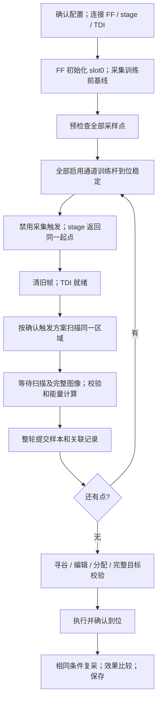
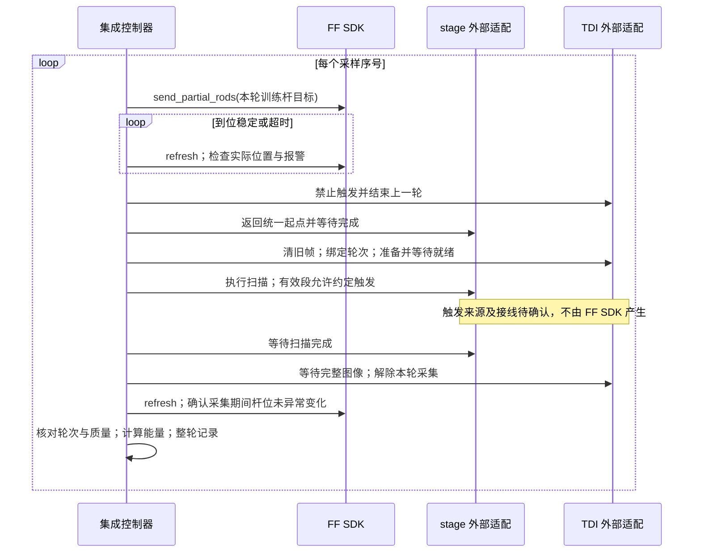

# Training：FF、stage 与 TDI 完整集成流程

本文面向集成开发人员，以“训练杆逐点稳定，每个位置由 stage 重复扫描同一区域，TDI 成像并计算能量”为主流程。常规操作见[应用场景指南](应用场景指南.md)。

**实现边界**：FF API 已存在；stage/TDI 调用均为外部适配伪代码。仓库没有 stage 驱动，当前 Itek 真实采集不可用，GUI Real 采集尚未接入。触发方式、相机数量及相机至 FF 通道映射尚待对接。本文指导完整编排，不代表真实联动已经实现或通过硬件验证。

## 1. 职责和联机前必须落实的输入

| 对象 | 职责 | 完成条件 |
| --- | --- | --- |
| 集成控制器 | 串行编排、错误处理、样本关联、能量计算、存储 | 每轮全部启用通道获得有效样本后才推进序号 |
| FF SDK | 杆运动、反馈、安全校验、寻谷、分配、执行、会话读写 | 实际位置进容差并保持稳定；下发成功不等于到位 |
| stage 外部适配 | 返回统一起点、执行同一区域扫描、反馈和停止 | 按确认的方向和速度覆盖同一有效区域，可关联本轮 |
| TDI 外部适配 | 固定参数、清缓冲、准备采集、交付图像、取消 | 当前轮次完整图像到齐，无缺帧、丢行和旧帧混入 |

| 输入        | 必须确认的内容                                                            |
| --------- | ------------------------------------------------------------------ |
| FF        | 启用通道、slot0、各通道 training_rod_id、P0/P1、范围、到位容差/稳定时间/超时和机械规则          |
| stage     | 起止坐标和单位、回程路径、扫描方向、速度/加减速、有效匀速段、回程和扫描超时                             |
| TDI       | 相机数量、相机/ROI 至 FF 通道映射、像素格式/位深、行数/图幅、增益/曝光、TDI 设置和传输完成判据            |
| 触发同步（待确认） | 编码器/内部/其他行触发来源、使能窗口、方向极性、首行对齐、丢触发处理；不能默认软件触发一帧即可完成 TDI 成像          |
| 速度匹配（待确认） | stage 速度、物方行间距与行频的关系；均匀空间行触发时名义关系为 行频=扫描速度/物方行间距，具体倍频和 TDI 模式按厂商确认 |
| 质量与验收     | ROI、暗场/背景校正、饱和与异常图像判据、保存目录、效果指标及工艺阈值                               |

这些输入由调用方采集配置保存，不扩展 FF SDK 公开类型。单相机多 ROI、多相机并行或逐相机采集都必须通过已确认映射生成每个通道的能量，不能将一个能量直接复制到全部通道。共享图像前须验证各通道可独立观测；不满足时由集成配置安排隔离后的独立采集。

## 2. 总流程与设备时序





扫描完成和图像传输完成是两个独立条件。图像未完整返回时不移动训练杆、不推进轮次；stage 回程期间禁止有效采集触发。

## 3. 初始化、采样设置与预检查

1. `open(config, mode, ports, enabledChannels)` 后读取 `machine_info()`。逐一核对启用通道 `trainingRod` 已配置，且为本通道 Layer 2 杆；不自动选第一根杆。
2. `initialize(slot0Path)` 并检查 `m_status.initialized`。连接成功不等于初始化完成。
3. 连接 stage/TDI，确认状态和采集配置。在约定基准杆位采集训练前基线，单独保存；训练及验证期间锁定光照、增益、曝光、扫描区域/方向/速度和 ROI。
4. 每通道设置起止光学毫米位置。默认 N=300，包括两个端点，2≤N≤100000；第 i 点 `p(i)=start+(end-start)*i/(N-1)`，支持正反方向。
5. 使用 `encoder=lround((p-P0)/P1)` 量化并复算毫米位置。检查 P1 非零、数值有限、整数范围、软硬限位和禁区。多个名义点可能量化为同一 count，样本保留真实反馈位置，不伪造等间距实际采样。
6. 刷新反馈，逐轮 `validate_rods()` 检查本轮各训练杆目标组合；运动时仍由 SDK 再校验。该检查不证明连续联合轨迹安全。

扫描范围来自机台标定和工艺，不能直接套用设计文档中的 ±26 mm。训练耗时包括杆运动、稳定、stage 回程、扫描、图像传输与计算，设计示意的 30 s 不是实际耗时承诺。

## 4. 完整主循环（外部适配伪代码）

下面不是可直接编译的厂商 SDK 示例。`require` / `require_value` 检查本次结果，保存错误后抛出；stage、tdi、acquisition、storage 均由调用方实现。FF 方法名称为真实公开 API。

```cpp
try {
  require(ff.open(configPath, mode, ports, enabledChannels));
  require(ff.initialize(slot0Path));
  require_initialized(ff.m_status);
  require(stage.connect(stageConfig));
  require(tdi.connect(cameraConfig));
  require(acquisition.validate_mapping_and_timing(scanConfig, cameraConfig));
  require(tdi.configure_and_lock(cameraConfig));
  archive = make_empty_archive(ff.m_config, enabledChannels, sampleCount);
  preflight_all_ff_scan_points(ff, scanSettings);
  baseline = capture_same_region(stage, tdi, acquisition, scanConfig, baselineId);
  storage.save_baseline(baseline);

  for (int i = 0; i < sampleCount; ++i) {
    check_cancel_requested();
    auto targets = quantized_training_rod_targets(i, scanSettings);
    require(ff.send_partial_rods(targets));
    // 同一控制线程 refresh：反馈有效、无报警、各杆进容差并连续稳定。
    // 容差外重置稳定计时；按杆超时退出；支持取消，禁止驱动并发重入。
    wait_all_rods_stable(ff, targets, scanSettings);
    auto before = copy_training_rod_feedback(ff);
    auto roundId = acquisition.new_round_id(i);
    auto images = capture_same_region(stage, tdi, acquisition, scanConfig, roundId);
    require(ff.refresh());
    auto after = copy_training_rod_feedback(ff);
    verify_rods_held_position(before, after, targets);
    auto round = acquisition.validate_and_measure(images, roundId, roiConfig);
    require_all_enabled_channels(round, enabledChannels);
    storage.save_images_and_manifest(roundId, images, before, after, round);
    // Sample 仅存实际光学毫米和 uint64 能量；元数据另存。
    append_complete_round(archive, before, round);
  }
  mark_scan_complete(archive); // 仅表示采样完成，不表示执行或验收通过。
  analyse_assign_validate_execute(ff, archive); // 见第 6 节
  auto verification = capture_same_region(stage, tdi, acquisition, scanConfig, verifyId);
  storage.save_verification(baseline, verification, acceptanceCriteria);
  require(ff.save_training_archive(sessionPath, archive));
  require(ff.record_positions(positionPath, "training result; acceptance recorded separately"));
} catch (...) {
  remember_primary_error();
  // 每一步均尝试并单独记录结果；清理失败不能跳过其他设备。
  try_cleanup([&] { return tdi.inhibit_triggers(); });
  try_cleanup([&] { return stage.stop(); });
  try_cleanup([&] { return tdi.cancel_acquisition(); });
  try_cleanup([&] { return ff.stop(); });
  // 若采样未完成则 complete=false；执行/验收失败另记业务状态。
  save_partial_archive_if_created(ff, archive, partialSessionPath);
  storage.save_failure_report();
}
// 正常和异常路径均执行；外部关闭应支持部分连接状态。
try_cleanup([&] { return tdi.inhibit_triggers(); });
try_cleanup([&] { return tdi.close(); });
try_cleanup([&] { return stage.close(); });
try_cleanup([&] { return ff.close(); });
```

`capture_same_region()` 的外部适配契约如下，所有方法均为伪代码：

```cpp
Images capture_same_region(Stage& stage, Tdi& tdi, Acquisition& acquisition,
                           const ScanConfig& config, RoundId id) {
  check_cancel_requested();
  require(tdi.inhibit_triggers());
  require(tdi.finish_or_cancel_previous(config.acquisitionTimeout));
  require(stage.return_to_start(config.start, config.returnTimeout));
  require(tdi.clear_old_frames());
  require(tdi.prepare(id, config.expectedImageLayout));
  require(tdi.wait_ready(config.readyTimeout));
  // 内部协调：有效段开启约定触发，离开有效段禁用；回程不采集。
  require(acquisition.start_scan_with_trigger_window(stage, tdi, config, id));
  require(stage.wait_scan_complete(config.scanTimeout));
  Images images = require_value(tdi.wait_complete_images(id, config.imageTimeout));
  require(tdi.inhibit_triggers());
  require(tdi.finish_acquisition(id));
  return images;
}
```

| 外部操作 | 输入、成功语义与超时责任 |
| --- | --- |
| connect / configure_and_lock | 设备标识和参数；适配层报告连接及参数确认结果，部分连接也可清理 |
| return_to_start | 统一坐标系起点、回程策略、超时；stage 适配等反馈完成，不仅返回已下发 |
| prepare / wait_ready | 本轮标识、图像布局、超时；TDI 适配确认全部参与相机就绪 |
| start_scan_with_trigger_window | 扫描方向/速度/有效段及触发配置；编排层协调 stage/TDI，就绪失败不扫描 |
| wait_scan_complete / wait_complete_images | 各自超时和同一轮次；均支持取消，扫描与传输独立等待，旧帧不能代替本轮 |
| stop / cancel_acquisition / close | 部分初始化后也可调用；返回本设备处理结果，由编排层逐项尝试、汇总失败、核对实际状态 |

## 5. 图像、能量与样本关联

每次运行分配独立 run ID，每轮分配唯一 round ID。外部 manifest 至少关联：采样序号、FF 通道/训练杆、名义毫米目标和量化 count、采集前后实际 count/mm、stage 起止位置及扫描标识、相机/图像标识、时间、ROI、参数版本、质量状态和能量。图像与 manifest 由调用方保存，FF 会话不含像素或 stage 轨迹。

能量采用固定 ROI 的像素灰度总和。核实位深、行跨度、有效像素；使用足够宽的累加器并检查 uint64 溢出，不能直接相加原始字节。校正、坏点和饱和处理在训练及前后验证中保持一致。校正若产生浮点或负数，先约定非负整数能量的转换尺度及截断规则，不能直接强转为 uint64。

每通道每轮只追加一个 `FF::Sample{实际光学毫米, 能量}`。缺帧/丢行、轮次错误、杆位异常变化、图像质量不合格或通道映射不足时，整轮不追加。跨文件写入不是事务，manifest 要区分完整轮次和残留文件。默认中止并保存部分数据，不自动重试、跳过坏点或自动回 slot0。

## 6. 寻谷、分配、执行与效果验证

1. `find_valleys(samples, settings)` 返回候选毫米位置，maximumCount 不超过可分配杆数。无候选应展示给用户确认，不凭空补点。
2. 编辑候选后重新分配。`interpolate_energy()` 用于曲线辅助，`drag_interval()` 不代替完整校验；GUI 额外执行候选最小 3 mm 间距规则，不能当作 SDK 所有输入的统一限制。
3. GUI 采用 `assign_training(ch, candidates, trainingRod)` 排除训练杆承担候选任务；示例采用相同策略。**排除承担候选不等于固定杆位**：有序 Layer 2 链的避让结果仍可能包含训练杆。
4. 保存并采用全部 Aim。assigned=true 是候选任务，assigned=false 也可能是必要避让目标，均须合入完整目标集。

以下是使用真实 FF API 的片段；需要 `<algorithm>` 和 `<DX_FF.h>`，`candidatesByChannel` 是调用方编辑后的各通道候选数组：

```cpp
auto refreshed = driver.refresh();
if (!refreshed || !driver.m_status.initialized) { /* 中止 */ return; }
const auto info = driver.machine_info();
std::vector<FF::Target> targets;
for (const auto& p : driver.m_current_positions) {
  if (!p.valid) { /* 中止，不采用无效反馈 */ return; }
  targets.push_back({p.address, p.encoder});
}
for (int ch = 0; ch < 3; ++ch) {
  if (!info.enabledChannels[ch]) continue;
  auto assigned = driver.assign_training(ch, candidatesByChannel[ch],
                                         info.channels[ch].trainingRod);
  if (!assigned) { /* 保存 assigned.result，返回编辑 */ return; }
  for (const auto& aim : assigned.value.aims) {
    auto target = std::find_if(targets.begin(), targets.end(), [&](const FF::Target& t) {
      return t.address.channel == aim.address.channel && t.address.rod == aim.address.rod;
    });
    if (target == targets.end()) { /* 地址不匹配，中止 */ return; }
    target->position = aim.encoderAim; // 包括 assigned=false 的避让项
  }
}
auto fresh = driver.refresh();
if (!fresh) return;
auto checked = driver.validate_rods(targets);
if (!checked) { /* 返回编辑/重新规划 */ return; }
// 展示最终目标与避让项，确认后执行；候选/状态变化则作废并重新规划。
auto moved = driver.move_rods(targets);
if (!moved) { /* 可能已部分运动；停止并刷新 */ return; }
```

规划至执行期间调用方禁止其他流程改动杆位；状态变化即作废计划。`move_rods()` 要求全部启用杆各一个目标，未返回 Aim 的杆保持快照位置。SDK 运动前重新校验，但不证明连续联合轨迹安全，也不保证硬实时同步启动。

5. 执行到位后，在相同区域、方向、速度、成像参数及 ROI 下复采。保存基线和训练后各通道图像、能量、指标计算与验收结论；阈值由工艺提供。寻谷和到位成功都不等于光学效果合格。
6. 无候选通道保持当前杆位；全部无候选不宣称有效优化。任一通道分配失败则不执行部分计划，保留数据供编辑。

## 7. 保存、加载和复用

| 产物 | API / 维护方 | 内容和使用边界 |
| --- | --- | --- |
| 多通道会话 | save_training_archive / load_training_archive | 新写 FF-TRAIN-3，含启用掩码、采样数、样本、候选、分配和执行目标 |
| 单通道会话 | save_training_session / load_training_session | 单通道写 FF-TRAIN-1；读取多通道文件仅返回保存时选中通道 |
| 杆位配方 | record_positions / save_positions | 新写 FF-POS-2；前者记录实际反馈，后者写调用方目标，不保存采样过程 |
| 图像、manifest、验收报告 | 调用方 | 图像关联、stage/TDI 配置及错误，不属于 FF 文件 |

TrainingArchive 填写机台/配置身份、UTC Unix 秒时间、实际 enabledChannels、selectedChannel、sampleCount；channels 固定三个物理槽位，未启用为 nullopt，启用填对应 TrainingSession。每个会话填写来源、训练杆、起止范围、采样数及实际数据。complete 仅代表扫描完成。

新归档 FF-TRAIN-3 仅列启用通道，数组逐项分行，小数最多三位；旧 FF-TRAIN-1/2 仍可读。stepMm 是兼容字段，新扫描按 sampleCount 和端点定点。SDK 保存路径与唯一名称由调用方管理，GUI 自动命名不属于 SDK API。

加载不运动。核对机台/版本、当前通道、训练杆和完整性，清除旧计划，再按当前反馈重新分配、校验、执行。配置不一致时仅离线查看；不直接提交旧执行目标。恢复已验收杆位使用另存的位置配方，按[场景指南](应用场景指南.md)处理完整或稀疏通道目标。

## 8. GUI 对应与异常处理

| 阶段 | 当前 GUI 操作 | 能力说明 |
| --- | --- | --- |
| 连接初始化 | Connection Center → Open → Initialize | 实际运动到 slot0；停止/复位后需重新初始化 |
| 扫描设置 | Training 各 CH 数据源/范围/训练杆；全局采样数与 Scan Settle | 训练杆由机台配置指定；默认 300 点、20 ms |
| 扫描 | Start Scan；可切 CH tab 查看 | 当前仿真能量，不控制 stage/TDI；扫描时冻结设置与候选编辑 |
| 编辑与执行 | Find Valleys、Clear Lines、候选编辑 → Plan → Execute | 操作可选全部/指定 CH；Execute 汇总启用 CH 有效计划，无候选 CH 保持原位 |
| 保存与复用 | Save Session / Load Session → 重新 Plan | 自动保存到 training_sessions，加载清除旧计划 |

| 失败阶段 | 必须处理的出口 |
| --- | --- |
| FF 非法目标、报警、到位超时 | 不触发本轮采集；保存错误与实际位置；停止后续动作 |
| stage 回程/扫描失败 | 禁止触发，停止 stage，取消 TDI，停止 FF 流程 |
| TDI 未就绪、缺帧/丢行、图像超时/异常 | 整轮不追加；停止参与设备，保留异常资料 |
| 用户取消/急停 | 不启动新轮，分别停止 stage、TDI 和 FF，保留部分样本，不自动回 slot0 |
| 分配/执行失败 | 保留采样和候选，废弃计划，检查实际反馈后再规划 |
| 存储失败 | 报告未保存产物和已有文件，不宣称保存成功，不覆盖成功记录作为补救 |

恢复按[场景六](应用场景指南.md)执行，默认新建训练运行，不自动续扫。可编译的纯 FF 仿真闭环见[仿真示例](仿真示例.md)，其通过不证明真实采集时序、机械或光学效果。
